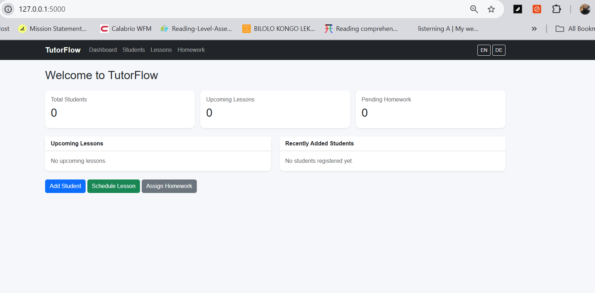
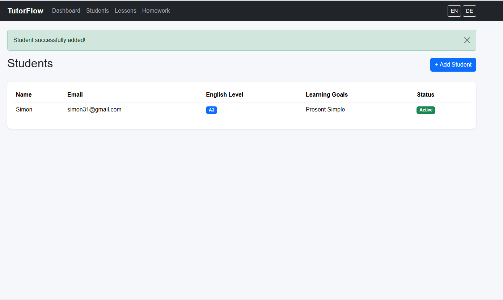
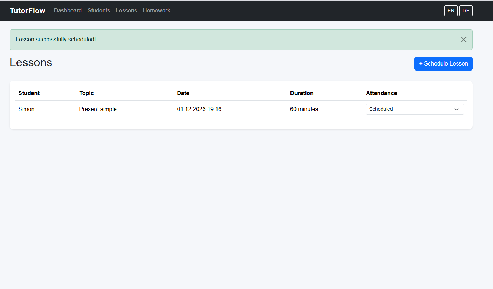
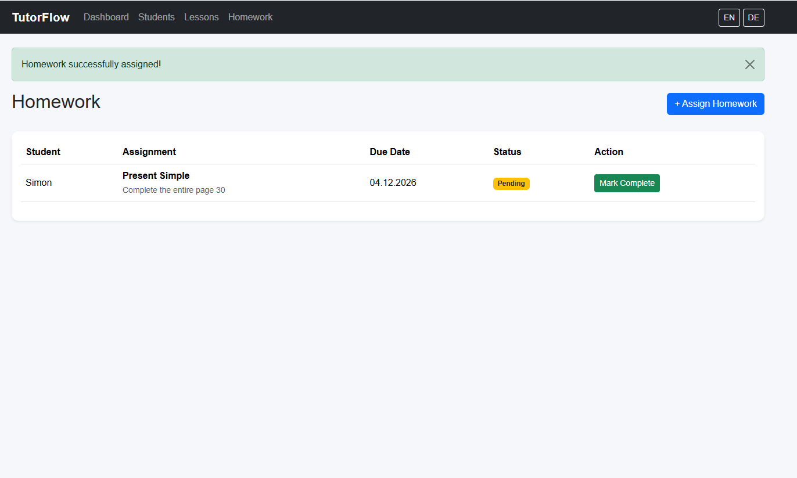

# TutorFlow — AWS Cloud Infrastructure & DevSecOps Project

**Building, deploying and operating a cloud-hosted application using AWS, Terraform, Docker and GitHub Actions.**

[](http://tutorflow-alb-878122358.eu-central-1.elb.amazonaws.com)
[](https://www.terraform.io/)
[](https://www.docker.com/)
[](https://github.com/features/actions)
[](https://aws.amazon.com/)

**Live application:** [TutorFlow](http://tutorflow-alb-878122358.eu-central-1.elb.amazonaws.com)  
**GitHub repository:** [MyTutor](https://github.com/paulevensdestima11-gif/MyTutor)  
**AWS Region:** Frankfurt (`eu-central-1`)  
**Project status:** Deployed — Active Development

---

# 1. Project Overview

TutorFlow is a practical cloud engineering project built around a Python-based tutoring management application.

The application provides a real workload for demonstrating how software can be developed locally and then deployed and operated as a cloud-hosted service.

However, the main engineering objective extends beyond application development.

**The project addresses a fundamental software delivery challenge: how to build an infrastructure environment that makes application deployment repeatable, controlled, secure and maintainable.**

A working application needs more than a server. It requires:

- Infrastructure that can be provisioned consistently.
- Network architecture that controls access between components.
- Compute resources that run the application reliably.
- Persistent database storage independent of the application container.
- Secure management of credentials and permissions.
- Automated testing and container image creation.
- A controlled deployment process with health checks and rollback capabilities.

TutorFlow demonstrates how these requirements can be implemented using AWS and DevSecOps practices.

## 2. The Engineering Problem

Deploying an application manually on a virtual machine may work for an initial demonstration, but it introduces operational challenges as the application evolves.

| Engineering challenge | Risk without a structured solution |
|---|---|
| Infrastructure provisioning | Manual configuration is difficult to reproduce and maintain. |
| Application hosting | Application runtime and infrastructure become dependent on manual server configuration. |
| Network security | Services may be exposed unnecessarily. |
| Data persistence | Application data may be tied to the application server or container lifecycle. |
| Credential management | Secrets may be exposed in source code or configuration files. |
| Software testing | Defects may reach deployment without automated checks. |
| Container management | Different releases may be difficult to identify and reproduce. |
| Deployment | Manual updates introduce human error and inconsistent procedures. |
| Recovery | Failed releases may leave the application unavailable. |

The objective of this project is to address these challenges through infrastructure automation, cloud-native services and an automated software delivery workflow.

## 3. The Cloud Engineering Solution

TutorFlow uses AWS infrastructure and automation to provide a structured environment for application hosting and deployment.

The solution is built around the following engineering capabilities.

| Capability | Implementation | Purpose |
|---|---|---|
| Infrastructure as Code | Terraform | Provision and manage AWS resources consistently. |
| Network architecture | Amazon VPC, subnets and security groups | Control communication and isolate infrastructure components. |
| Application access | Application Load Balancer | Provide a central public entry point. |
| Compute | Amazon EC2 | Run the application container. |
| Containerisation | Docker | Package application code and dependencies. |
| Container registry | Amazon ECR | Store versioned application images. |
| Database | Amazon RDS PostgreSQL | Provide persistent managed database storage. |
| Secrets management | AWS Secrets Manager | Store application database credentials. |
| Access management | AWS IAM | Apply identity-based permissions. |
| CI/CD | GitHub Actions | Automate testing, building and deployment workflows. |
| Cloud authentication | GitHub OIDC | Authenticate CI/CD workflows without long-lived AWS access keys. |
| Remote deployment | AWS Systems Manager | Execute deployment operations without SSH access. |
| Deployment validation | Health checks and rollback | Reduce the risk of introducing faulty application releases. |

The goal is to demonstrate how these services work together as one operating environment rather than as isolated AWS resources.

---

# 4. AWS Architecture

TutorFlow is deployed in the AWS Frankfurt region (`eu-central-1`).

## Architecture diagram

```text
                         INTERNET
                            |
                            | HTTP :80
                            |
                 Application Load Balancer
                    /                \
             Public Subnet A     Public Subnet B
                    |
                    | HTTP :8000
                    |
              Amazon EC2
           Amazon Linux 2023
                    |
                Docker
                    |
             Gunicorn / Flask
                    |
                    | PostgreSQL :5432
                    |
           Amazon RDS PostgreSQL
                Private Subnets
```

## Architecture components

### Amazon VPC and networking

**Problem addressed:** Application infrastructure should not be accessible through unrestricted network connections.

Implementation:

- Dedicated VPC using the `10.20.0.0/16` address range.
- Two public subnets across separate Availability Zones.
- Two private subnets for database networking.
- Internet Gateway for public internet connectivity.
- Security groups controlling communication between infrastructure components.

### Application Load Balancer

**Problem addressed:** Provide a central public entry point without exposing the application server directly.

Implementation:

- Public Application Load Balancer.
- HTTP listener on port 80.
- Target group forwarding requests to EC2 on port 8000.
- Health checks to verify application availability.
- EC2 security group allows application traffic only from the ALB security group.

### Amazon EC2 and Docker

**Problem addressed:** Run the application in a consistent and replaceable execution environment.

Implementation:

- Amazon Linux 2023.
- EC2 `t3.micro` instance.
- Docker Engine.
- Gunicorn application server.
- Non-root container execution using `appuser`.
- Versioned application images retrieved from Amazon ECR.

### Amazon RDS PostgreSQL

**Problem addressed:** Separate persistent application data from the application runtime.

Implementation:

- Managed PostgreSQL database.
- Private subnet deployment.
- Dedicated application database user.
- Application-to-database connectivity restricted through security groups.
- Encrypted database storage.
- Database schema managed using Flask-Migrate and Alembic.

### AWS Secrets Manager and IAM

**Problem addressed:** Avoid embedding database credentials and AWS access keys in application code or container images.

Implementation:

- Application database credentials stored in Secrets Manager.
- EC2 instance profile used to retrieve the application secret.
- Dedicated IAM permissions for application operations.
- Separate GitHub Actions IAM role for CI/CD operations.
- EC2 does not require access to the RDS master credentials.

---

# 5. Infrastructure as Code — Terraform

The AWS environment is provisioned and managed using Terraform.

Instead of manually creating cloud resources, infrastructure is defined through version-controlled configuration files.

Terraform manages:

- VPC and subnet configuration.
- Internet Gateway and routing.
- Security groups.
- EC2 instance and IAM instance profile.
- Application Load Balancer.
- Target groups and listeners.
- Amazon ECR repository.
- Amazon RDS PostgreSQL.
- IAM roles and policies.
- Secrets Manager integration.
- GitHub OIDC identity provider.
- GitHub Actions deployment permissions.

### Infrastructure workflow

```powershell
terraform init
terraform fmt
terraform validate
terraform plan
terraform apply
```

Changes are reviewed through `terraform plan` before being applied.

**Engineering benefit:** Infrastructure can be reviewed, version-controlled and managed through a repeatable process instead of relying on undocumented manual configuration.

---

# 6. CI/CD — GitHub Actions

A central part of this project is the automated delivery pipeline.

The pipeline connects application development, testing, container image creation and AWS deployment.

Three GitHub Actions workflows are implemented.

## Workflow 1: Continuous Integration

File: `.github/workflows/ci.yml`

Triggered when code is pushed to the `main` branch.

Responsibilities:

1. Check out the repository.
2. Configure Python.
3. Install application dependencies.
4. Execute automated tests.
5. Generate coverage results.

The Docker build workflow depends on successful completion of CI.

**Purpose:** Prevent application changes from proceeding to image creation when automated tests fail.

## Workflow 2: Docker Build and Amazon ECR

File: `.github/workflows/docker-build.yml`

Triggered after the CI workflow completes successfully.

Responsibilities:

1. Check out the exact source commit.
2. Authenticate to AWS through GitHub OIDC.
3. Build the Docker image.
4. Tag the image with the full Git commit SHA.
5. Push the image to Amazon ECR.
6. Update the `latest` image tag.

Each versioned image can be traced back to its source commit.

**Purpose:** Produce identifiable and reproducible application deployment artifacts.

## Workflow 3: Production Deployment

File: `.github/workflows/deploy.yml`

Production deployment is manually initiated using GitHub Actions `workflow_dispatch`.

Responsibilities:

1. Validate the supplied 40-character Git commit SHA.
2. Check out the matching deployment script.
3. Authenticate to AWS through OIDC.
4. Submit the deployment command through AWS Systems Manager.
5. Wait for remote execution.
6. Report deployment success or failure.

**Purpose:** Provide a controlled production release process rather than relying on manual SSH access and commands.

---

# 7. Deployment Strategy — Health Checks and Rollback

The deployment process uses a candidate container before replacing the existing production container.

This provides an opportunity to validate the new application version before the production cutover.

## Deployment sequence

```text
GitHub Actions
      |
      v
AWS Systems Manager
      |
      v
EC2 retrieves image from ECR
      |
      v
Start candidate container
      |
      v
Run health checks
      |
      +------ Failure
      |          |
      |          v
      |      Remove candidate
      |      Keep production unchanged
      |
      v
Candidate passes checks
      |
      v
Stop and remove candidate
      |
      v
Replace production container
      |
      v
Verify production health
      |
      +------ Failure
      |          |
      |          v
      |      Restore previous container
      |
      v
Deployment successful
```

The candidate container runs on a separate local port during validation.

The deployment script checks:

- Application root endpoint (`/`).
- Student management endpoint (`/students/`).

After successful candidate validation, the previous production container is retained under a rollback name.

If the new production container fails its health checks, the deployment script attempts to restore the previous container.

**Engineering benefit:** Deployment failures have a defined recovery path, reducing the risk of leaving production in a broken state.

This is a controlled replacement deployment, not a zero-downtime deployment.

---

# 8. Cloud Security and Identity Management

Security is applied across the application, infrastructure and delivery pipeline.

## GitHub Actions OIDC

GitHub Actions assumes an AWS IAM role using OpenID Connect.

This avoids storing long-lived AWS access keys in GitHub repository secrets.

The IAM trust policy restricts access to the designated repository and branch.

## IAM permissions

Different responsibilities use separate IAM permissions.

- GitHub Actions can push images to the designated ECR repository.
- GitHub Actions can initiate deployment commands through SSM.
- EC2 can pull images from ECR.
- EC2 can retrieve the application secret from Secrets Manager.
- EC2 can communicate with Systems Manager.

## Network security

- ALB accepts public traffic on HTTP port 80.
- EC2 port 8000 is restricted to the ALB security group.
- RDS port 5432 is restricted to the EC2 security group.
- RDS is deployed in private subnets.

## Application and container security

- Flask application secret supplied through environment configuration.
- Database credentials stored in Secrets Manager.
- CSRF protection enabled.
- Docker container runs as a non-root user.
- `.dockerignore` excludes unnecessary files and local secrets.

---

# 9. Database Migration

TutorFlow initially used SQLite with persistent Docker volume storage.

The production application was subsequently migrated to Amazon RDS PostgreSQL.

The migration process included:

1. Creating and verifying a SQLite database backup.
2. Provisioning RDS PostgreSQL using Terraform.
3. Creating a dedicated PostgreSQL application user.
4. Applying the database schema using Flask-Migrate and Alembic.
5. Migrating existing student records.
6. Verifying database integrity and record counts.
7. Switching the production application to PostgreSQL.
8. Verifying Flask database connectivity and application functionality.

The migration successfully transferred the existing two student records.

The original SQLite Docker volume and backup file were retained as rollback safeguards.

This demonstrates a practical database migration from local persistent storage to a managed cloud database.

---

# 10. Application Overview

TutorFlow provides the business workload used to demonstrate the cloud architecture.

It is a Python-based tutoring management application designed to help independent tutors organise their teaching activities.

## The problem

Independent tutors need to manage several connected responsibilities:

- Student information.
- Lesson organisation.
- Homework assignments.
- Learning activities.
- Educational materials.
- Student progress.

Managing these activities across separate documents and tools can create unnecessary administrative work.

## The solution

TutorFlow brings these activities together in a central application.

### Current application features

| Feature | Description |
|---|---|
| Student Management | Register and manage student records. |
| Lesson Management | Create and organise lessons. |
| Homework Management | Assign and manage homework. |
| Dashboard | Main tutoring management interface. |
| Database Migrations | Schema management using Flask-Migrate and Alembic. |
| Form Security | CSRF protection using Flask-WTF. |
| Language Support | English and German interface support. |

Progress tracking and learning materials have database foundations, with further user-facing functionality planned.

## Application architecture

```text
app/
│
├── models/
├── routes/
│   ├── dashboard.py
│   ├── students.py
│   ├── lessons.py
│   └── homework.py
├── templates/
├── static/
├── extensions.py
└── __init__.py
```

The Flask application uses a modular structure with separate models, routes, templates and extensions.

## Screenshots

### Dashboard



### Student Management



### Lesson Management



### Homework Management



---

# 11. Technology Stack

| Area | Technology |
|---|---|
| Programming Language | Python 3.14 |
| Web Framework | Flask |
| Application Server | Gunicorn |
| Database ORM | SQLAlchemy |
| Database | PostgreSQL / SQLite |
| Database Migrations | Flask-Migrate / Alembic |
| Containerisation | Docker |
| Container Registry | Amazon ECR |
| Cloud Platform | AWS |
| Infrastructure as Code | Terraform |
| Networking | VPC, Subnets, Security Groups, ALB |
| Compute | Amazon EC2 |
| Database Hosting | Amazon RDS |
| Secrets Management | AWS Secrets Manager |
| Identity and Access | AWS IAM / OIDC |
| Remote Management | AWS Systems Manager |
| CI/CD | GitHub Actions |
| Testing | pytest / pytest-cov |
| Version Control | Git / GitHub |

---

# 12. Local Development

## Prerequisites

- Python 3.14.
- Git.
- Docker Desktop (optional).

## Clone the repository

```powershell
git clone https://github.com/paulevensdestima11-gif/MyTutor.git
cd MyTutor
```

## Create a virtual environment

```powershell
python -m venv .venv
.venv\Scripts\Activate.ps1
```

## Install dependencies

```powershell
python -m pip install --upgrade pip
pip install -r requirements.txt
pip install pytest pytest-cov
```

## Configure environment variables

Create a `.env` file in the project root:

```env
SECRET_KEY=your-generated-secret-key
DATABASE_URL=sqlite:///tutorflow.db
```

Generate a secret key:

```powershell
python -c "import secrets; print(secrets.token_urlsafe(32))"
```

Never commit `.env` files or real credentials to GitHub.

## Initialise the database

```powershell
flask --app run db upgrade
```

## Start the application

```powershell
python run.py
```

Open the local address displayed in the terminal.

---

# 13. Docker Development

## Build the image

```powershell
docker build -t tutorflow:local .
```

## Create persistent storage

```powershell
docker volume create tutorflow_data
```

## Generate an application secret

```powershell
$secret = python -c "import secrets; print(secrets.token_urlsafe(32))"
```

## Start the container

```powershell
docker run -d `
  --name tutorflow `
  -p 8000:8000 `
  -e "SECRET_KEY=$secret" `
  -e "DATABASE_URL=sqlite:///tutorflow.db" `
  -v tutorflow_data:/app/instance `
  tutorflow:local
```

Clear the temporary secret variable:

```powershell
$secret = $null
```

## Apply database migrations

```powershell
docker exec tutorflow flask --app run:app db upgrade
```

## Access the application

```text
http://localhost:8000
```

## Verify the container

```powershell
docker ps
docker logs tutorflow
docker exec tutorflow whoami
```

The container runs under a non-root Linux user.

---

# 14. Automated Testing

Run the test suite:

```powershell
pytest -v
```

Generate coverage results:

```powershell
pytest --cov=app --cov-report=term-missing
```

Previous local test results:

- 9 passing tests.
- 81% application code coverage.

GitHub Actions executes the automated test suite on pushes to `main`.

---

# 15. Current Limitations and Future Improvements

The current implementation demonstrates a working cloud deployment and automated delivery process.

However, it is important to distinguish implemented capabilities from production-hardening work that remains outstanding.

| Area | Current state | Future improvement |
|---|---|---|
| Application availability | Single EC2 instance | Multi-instance deployment and Auto Scaling. |
| Database availability | Single-AZ RDS | Evaluate Multi-AZ deployment. |
| Transport security | HTTP listener | HTTPS using ACM. |
| Application security | CSRF and infrastructure-level controls | Authentication and authorisation. |
| Credentials | Secrets Manager | Automated credential rotation. |
| Database recovery | One-day backup retention | Test backup restoration and recovery. |
| Monitoring | Basic application and deployment health checks | CloudWatch dashboards, metrics and alarms. |
| Deployment | Candidate validation and container rollback | Stronger deployment resilience and automated post-deployment verification. |
| Network architecture | EC2 in a public subnet | Evaluate private application hosting and managed outbound connectivity. |

The project is currently intended as a learning and engineering portfolio demonstration, not a production-ready platform for real student data.

---

# 16. What This Project Demonstrates

TutorFlow demonstrates practical experience in designing and operating a cloud-hosted application.

### Cloud Engineering

- AWS VPC and network architecture.
- Public and private subnet design.
- Application Load Balancer configuration.
- EC2 application hosting.
- Amazon RDS PostgreSQL integration.
- Security group design.

### Infrastructure Automation

- Terraform configuration.
- Infrastructure provisioning.
- Infrastructure change planning.
- AWS CLI operations.

### DevSecOps

- Docker image creation.
- Amazon ECR integration.
- GitHub Actions CI/CD.
- OIDC-based AWS authentication.
- IAM least-privilege permissions.
- AWS Secrets Manager integration.
- Automated application testing.

### Deployment and Operations

- AWS Systems Manager remote deployment.
- Versioned Docker images.
- Candidate container health checks.
- Production container replacement.
- Rollback to a previous application container.
- Database migration and verification.

## Final Objective

**The purpose of TutorFlow is not simply to demonstrate that an application can run on AWS. It is to demonstrate how cloud infrastructure, Infrastructure as Code, security controls and CI/CD automation can work together to make software delivery more repeatable, controlled and maintainable.**

The tutoring application provides the real-world workload. The AWS infrastructure and DevSecOps pipeline demonstrate the engineering capabilities required to deploy and operate it.

---

**Author:** Paul  
**Project:** TutorFlow  
**Engineering Focus:** AWS Cloud Engineering · Terraform · Docker · CI/CD · DevSecOps
