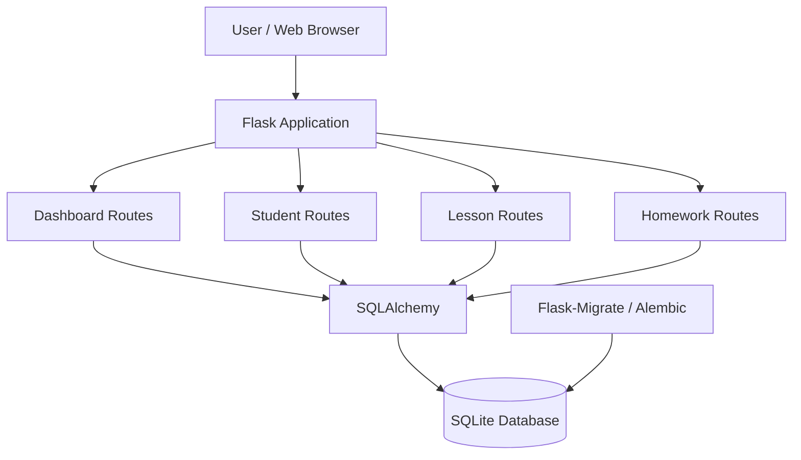
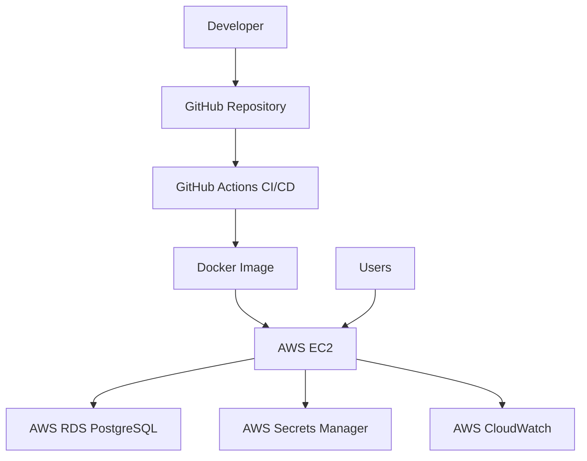

# TutorFlow — System Architecture

## 1. Overview

TutorFlow is a Flask-based tutoring management application. Its architecture separates application routes, business models, database access and presentation.

## 2. Current Architecture

The current application runs locally and uses SQLite.

## 3. Planned AWS Architecture

The AWS architecture is a planned deployment target, not a currently deployed environment.

## 4. Technology Stack

| Layer | Technology |
|---|---|
| Backend | Python, Flask |
| Database ORM | SQLAlchemy |
| Current database | SQLite |
| Planned database | PostgreSQL on AWS RDS |
| Migrations | Flask-Migrate, Alembic |
| Form security | Flask-WTF, CSRF |
| Version control | Git, GitHub |
| Planned infrastructure | AWS, Terraform |
| Planned containerization | Docker |
| Planned CI/CD | GitHub Actions |

## 5. Deployment Roadmap

1. Containerize the Flask application.
2. Provision AWS infrastructure using Terraform.
3. Deploy the application to EC2.
4. Configure PostgreSQL using RDS.
5. Store production secrets in AWS Secrets Manager.
6. Implement CI/CD using GitHub Actions.
7. Add CloudWatch monitoring and logging.
8. Configure HTTPS and production security controls.